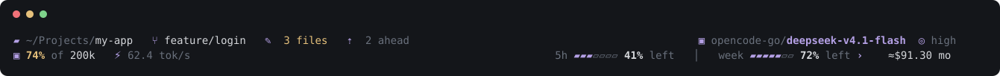
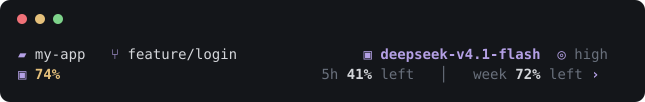
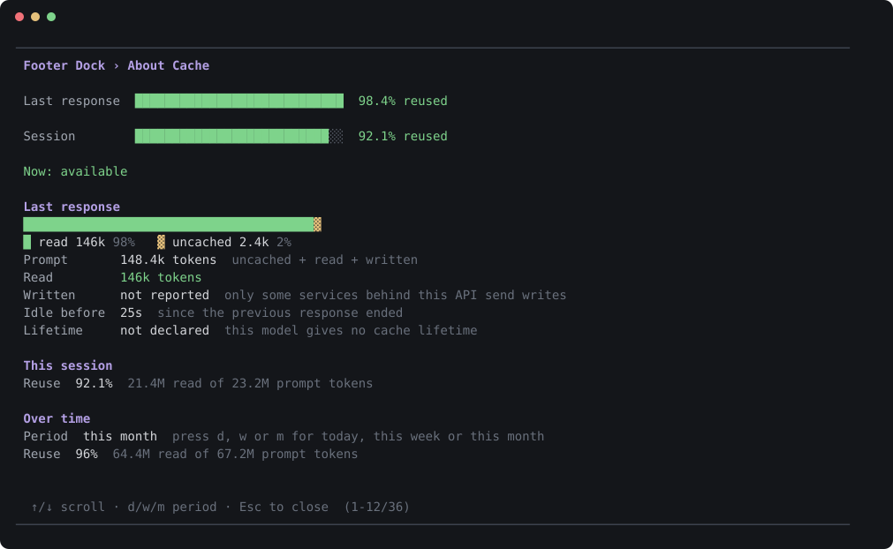
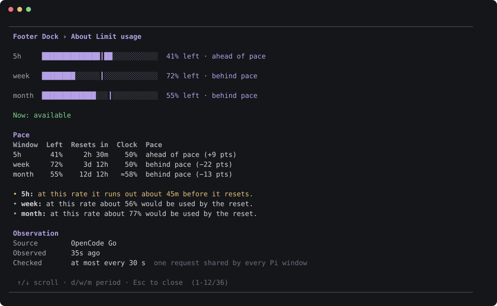
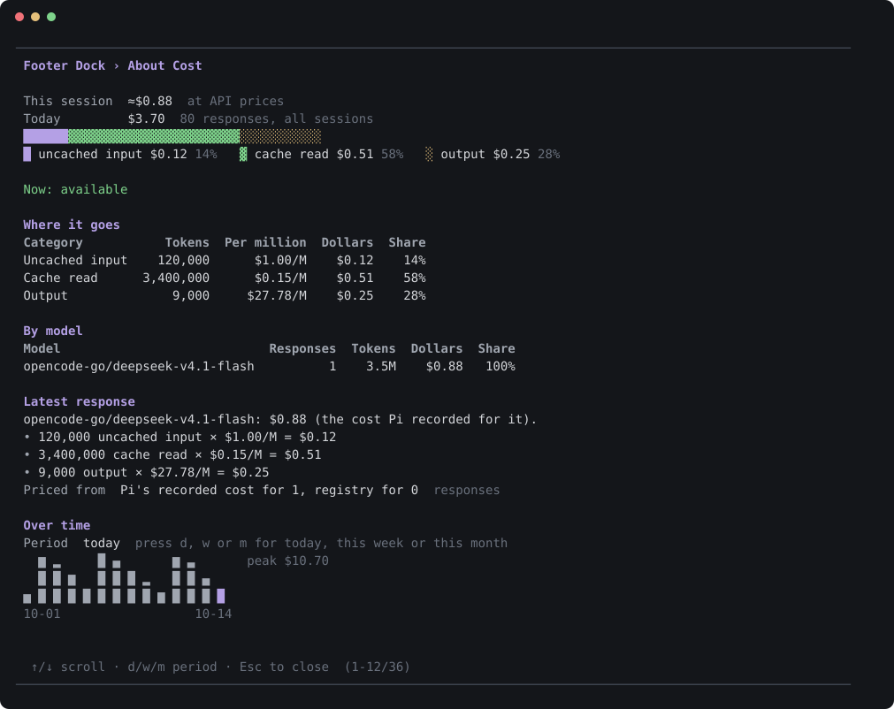
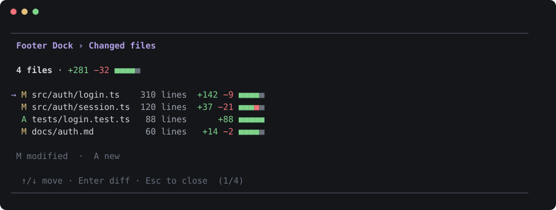
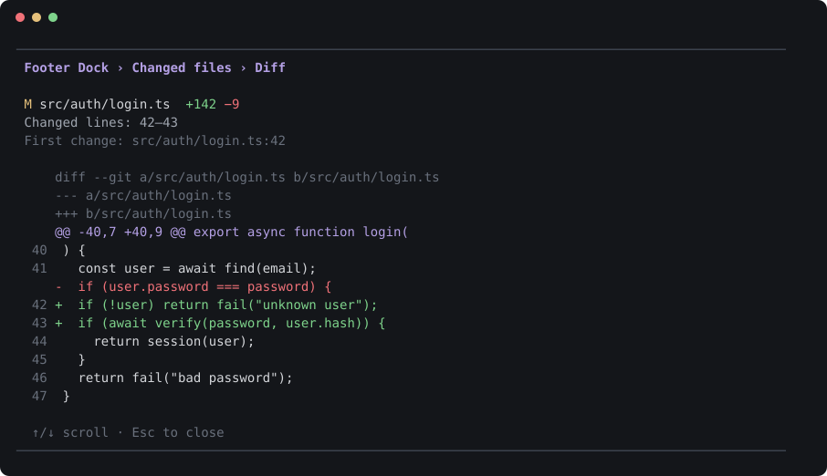
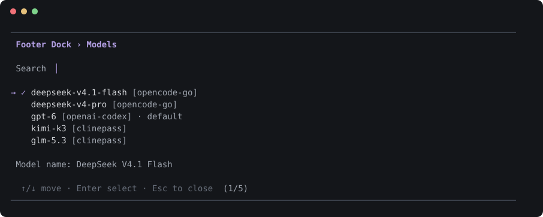

# Footer Dock

**A two-row status footer for [Pi](https://pi.dev) that tells you what is going on.** Git, model, context, tokens, cache, speed, provider limits and cost, in two rows that fit your terminal, with an explanation behind every value.





The footer chooses what to show for the width you have. Nothing is cut in the middle of a value: items drop out whole, least important first, and the project name goes last.

## Install

```bash
pi install npm:pi-footer-dock
```

Then restart Pi (or run `/reload`). That is all. Full instructions, updating, removing and troubleshooting: **[SETUP.md](SETUP.md)**.

## What the footer shows

| Item           | What it is                                                                         | Click the icon                            | Click the text |
| -------------- | ---------------------------------------------------------------------------------- | ----------------------------------------- | -------------- |
| Project folder | Where Pi is working                                                                | Opens it in your file manager             | Explains       |
| Git branch     | The checked-out branch                                                             | Lists branches; Enter prepares the switch | Explains       |
| Changed files  | Files with uncommitted changes                                                     | Lists them; Enter shows the diff          | Explains       |
| Commits ahead  | Commits not pushed yet                                                             | Shows where Git is                        | Explains       |
| Model          | Provider and model                                                                 | Picks another model (with search)         | Explains       |
| Thinking level | The model's reasoning level                                                        | Picks another level                       | Explains       |
| Context        | How much of the context window is used, and when Pi will compact                   |                                           | Explains       |
| Input, output  | Tokens used in this session                                                        |                                           | Explains       |
| Cache          | How much of the last prompt came from the provider's cache                         |                                           | Explains       |
| Speed          | Output tokens per second of the last response                                      |                                           | Explains       |
| Limit usage    | What is left of the provider's 5-hour, weekly and monthly limits, with reset times |                                           | Explains       |
| Cost           | What this month (or week, day, session) would cost at API prices                   |                                           | Explains       |

## Every value explains itself

Click the text of any item. The explanation is a live screen, not a paragraph: it updates while it is open, scrolls with the wheel and the arrow keys, and always says **what the value reports** and **when it can be missing**.



Limit usage shows, for each window, whether you are **ahead of or behind the pace** that would last until the reset, and what every marker means:



Cost shows where the money went, by category and by model, and over days, weeks and months (press `d`, `w` or `m`):



## Look at your changes

Click the changed-files icon. Move with the arrows, search by typing, press Enter for the diff. The diff carries the line numbers the file has now, and lists the changed lines at the top, so you can find them in your editor.





The list and the diff look again every couple of seconds while they are open, so new changes appear by themselves.

## Pick a model or a thinking level

Click the robot or the brain icon. Type to search, Enter to choose, Esc to close; the same icon closes it again.



## Settings

Run `/dock-settings`. Hide any item (at every width or only on narrow ones), choose which limit windows stay when the footer is tight, show limits as percent left or used, choose the period of the footer cost, switch icon sets, and more. Settings are saved in Pi's folder and shared by every Pi window.

## Provider limits: what it asks, and how to turn it off

For **ClinePass**, **OpenCode Go** and **OpenAI Codex**, Footer Dock shows the limit windows the provider itself reports, with their reset times. To do that it asks the provider's own usage service, with the credential Pi already holds for that provider (obtained through Pi's public API; Footer Dock never reads credential files), at most once every 30 seconds across all your Pi windows. These usage services are **not documented as stable**: if one changes, the windows disappear rather than being guessed.

Prefer to send nothing? Set **Ask providers for limits** to **off** in `/dock-settings`. Other providers show no limits, because there is nothing to ask.

## Privacy and safety

- **No telemetry, no accounts, no servers of ours.** Footer Dock makes no network request except the provider limit check above, and that only for the three providers named there.
- **Credentials:** obtained from Pi at the moment of a request, sent only to the provider's fixed address, never stored, never logged, never shown.
- **Git is read-only and inert.** Footer Dock only reads. It switches off every program a repository's own configuration could make Git run (`core.fsmonitor`, textconv, external diff, filters and so on), so opening a hostile repository cannot run code. It never switches branches itself: choosing a branch only prepares the `git switch` command in your message box for you to run.
- **Your history stays on your machine.** The cost history is built from Pi's own session logs and cached under your user cache folder; only numbers and folder names are kept, never messages.
- Files it writes: `pi-footer-dock.json` (settings) in Pi's folder, and a rebuildable cache under `~/.cache/pi-footer-dock`. Both are private to your user.

## Requirements

- Pi 1.2 or newer, and Node.js 22.19 or newer (the same as Pi).
- A terminal with mouse support for clicking (everything also works from the keyboard and with `/dock-*` commands). A Nerd Font gives the best icons; `/dock-glyphs` switches to portable symbols.
- Tested on Linux. macOS and Windows are expected to work; opening the project folder with the system file manager has not been run on them yet.

## Commands

| Command               | What it does                                               |
| --------------------- | ---------------------------------------------------------- |
| `/dock-settings`      | The settings menu                                          |
| `/dock-info [item]`   | Explains a footer item                                     |
| `/dock-quota`         | Shows or hides the collapsed limit windows                 |
| `/dock-open`          | Opens the project folder in your file manager              |
| `/dock-open-with ...` | Chooses another app for that, for example `thunar {path}`  |
| `/dock-glyphs`        | Switches between Nerd Font and portable icons              |
| `/dock-refresh`       | Reads Git and usage again                                  |
| `/dock-config ...`    | Session-only footer configuration as JSON                  |
| `/dock-debug`         | Safe diagnostics for a bug report (no content, no secrets) |

## Large repositories

The Git items watch the repository for changes. If a repository is too large to watch (thousands of directories), Footer Dock falls back to reading Git after each Pi action and says so in the item's explanation; it never shows a number it did not read.

## For other extensions

Extensions can have Footer Dock manage their footer items, settings and explanations, and Footer Dock needs to know nothing about them: see **[docs/extending-footer-dock.md](docs/extending-footer-dock.md)**.

## Contributing, security, license

[CONTRIBUTING.md](CONTRIBUTING.md) · [SECURITY.md](SECURITY.md) · [CHANGELOG.md](CHANGELOG.md) · Apache License 2.0, see [LICENSE](LICENSE).
